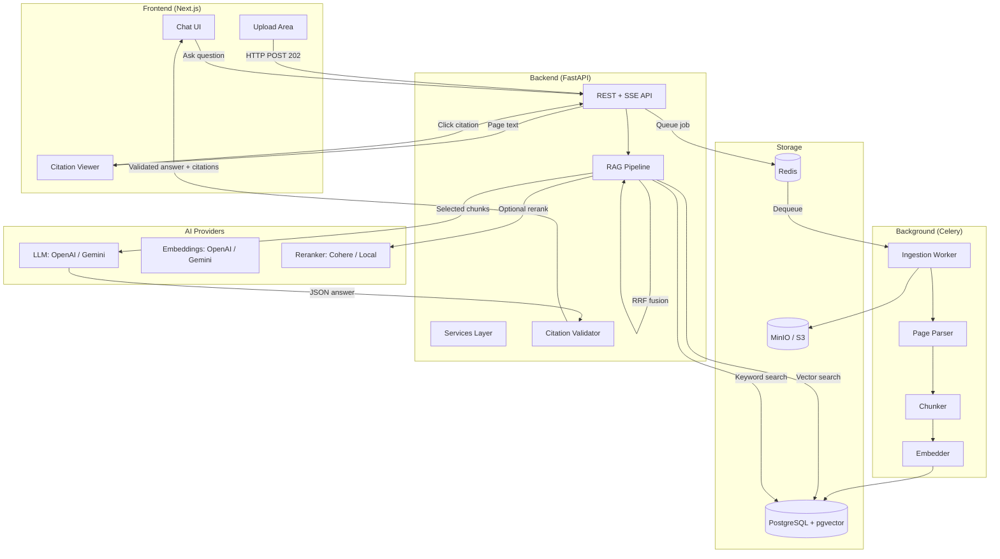
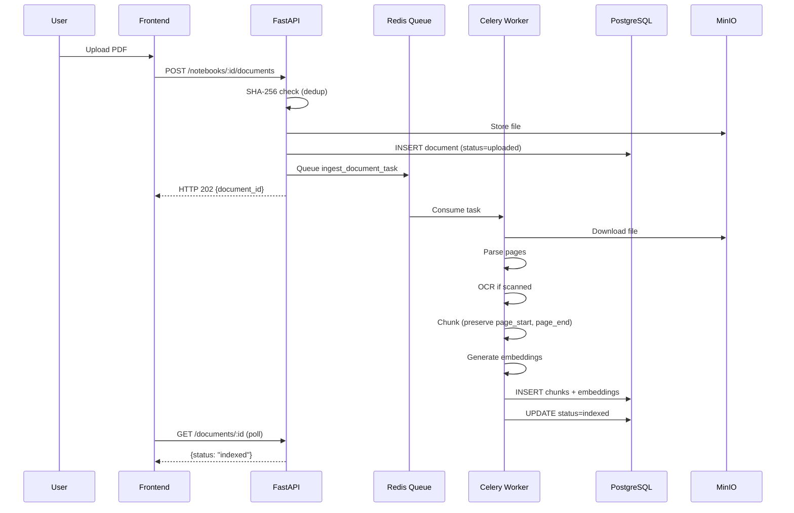

# NotebookLM Lite

> **Citation-first document question-answering application.**
> 
> Every sentence in every answer is backed by a numbered citation linked to the exact source page. No outside knowledge. No hallucinations.

---

## Table of Contents

1. [Project Overview](#1-project-overview)
2. [Architecture](#2-architecture)
3. [Features](#3-features)
4. [Tech Stack](#4-tech-stack)
5. [Folder Structure](#5-folder-structure)
6. [Environment Setup](#6-environment-setup)
7. [Docker Setup](#7-docker-setup)
8. [Database Setup](#8-database-setup)
9. [How Ingestion Works](#9-how-ingestion-works)
10. [How Retrieval Works](#10-how-retrieval-works)
11. [How Citations Work](#11-how-citations-work)
12. [API Documentation](#12-api-documentation)
13. [Evaluation Methodology](#13-evaluation-methodology)
14. [Testing](#14-testing)
15. [Troubleshooting](#15-troubleshooting)
16. [Interview Explanation](#16-interview-explanation)
17. [Future Improvements](#17-future-improvements)

---

## 1. Project Overview

NotebookLM Lite is a **production-quality RAG (Retrieval-Augmented Generation)** application where:

- Users create **notebooks** and upload **PDF, Markdown, or plain-text documents**
- Documents are **parsed page-by-page**, chunked, embedded, and indexed
- Users ask questions in a **conversational chat interface**
- The LLM answers **only from retrieved chunks** with numbered citations like `[1]`
- Each citation links to the **exact page** in the source document
- Questions with no answer in the documents return `{ "not_found": true }`

---

## 2. Architecture



### Data Flow



---

## 3. Features

### M1 — Foundation ✅
- [x] Notebook CRUD
- [x] Document upload (PDF, MD, TXT)
- [x] SHA-256 deduplication
- [x] Object storage (MinIO/S3)
- [x] Document status tracking
- [x] Background ingestion queue (Celery + Redis)
- [x] Health/readiness endpoints

### M2 — Parse + Chunk (upcoming)
- [ ] PDF parsing page-by-page (PyMuPDF)
- [ ] OCR for scanned pages (Tesseract)
- [ ] Intelligent chunking with page preservation
- [ ] Markdown and plain text parsing

### M3 — Embed + Search (upcoming)
- [ ] Configurable embedding provider (OpenAI, Gemini)
- [ ] pgvector HNSW index
- [ ] PostgreSQL full-text search
- [ ] Debug retrieval view

### M4 — Answer with Citations (upcoming)
- [ ] Hybrid retrieval (vector + keyword)
- [ ] Reciprocal Rank Fusion (RRF)
- [ ] LLM prompt with citation system
- [ ] SSE streaming
- [ ] Conversational follow-up rewriting

### M5 — Validate Citations (upcoming)
- [ ] Citation validation engine
- [ ] Citation database records
- [ ] Page viewer / quote highlighting

### M6 — Evals (upcoming)
- [ ] Optional reranker
- [ ] Evaluation framework
- [ ] Evaluation metrics dashboard

---

## 4. Tech Stack

| Layer | Technology |
|-------|-----------|
| Frontend | Next.js 15, TypeScript, Tailwind CSS |
| Backend API | Python 3.11, FastAPI, Pydantic v2 |
| Database | PostgreSQL 16, pgvector extension |
| Background Jobs | Celery 5, Redis 7 |
| Object Storage | MinIO (local), S3-compatible (production) |
| PDF Parsing | PyMuPDF (fitz), pdfplumber |
| OCR | Tesseract OCR via pytesseract |
| Embeddings | OpenAI / Gemini (configurable) |
| LLM | OpenAI GPT / Google Gemini (configurable) |
| Reranker | Cohere / local cross-encoder (configurable) |
| Containerization | Docker, Docker Compose |

---

## 5. Folder Structure

```
notebooklm-lite/
├── backend/
│   ├── app/
│   │   ├── api/               # FastAPI route handlers
│   │   │   ├── notebooks.py
│   │   │   ├── documents.py
│   │   │   └── health.py
│   │   ├── core/              # Config, logging
│   │   │   ├── config.py
│   │   │   └── logging.py
│   │   ├── db/                # Database session + repositories
│   │   │   ├── session.py
│   │   │   ├── notebook_repo.py
│   │   │   └── document_repo.py
│   │   ├── models/            # SQLAlchemy ORM models
│   │   │   └── models.py
│   │   ├── schemas/           # Pydantic request/response schemas
│   │   │   └── schemas.py
│   │   ├── services/          # Business logic
│   │   │   ├── notebook_service.py
│   │   │   ├── document_service.py
│   │   │   └── storage.py
│   │   ├── rag/               # Retrieval + LLM (M3+)
│   │   ├── ingestion/         # Parse + chunk + embed pipeline
│   │   │   └── pipeline.py
│   │   ├── workers/           # Celery tasks
│   │   │   ├── celery_app.py
│   │   │   └── tasks.py
│   │   ├── evaluations/       # Eval framework (M6)
│   │   └── main.py
│   ├── tests/
│   │   └── test_m1_upload.py
│   ├── requirements.txt
│   ├── pytest.ini
│   └── Dockerfile
│
├── frontend/
│   ├── app/
│   │   ├── layout.tsx
│   │   ├── page.tsx           # Main page with sidebar
│   │   └── globals.css
│   ├── components/
│   │   ├── CreateNotebookModal.tsx
│   │   └── NotebookView.tsx
│   ├── lib/
│   │   └── api.ts             # Typed API client
│   ├── types/
│   │   └── index.ts           # TypeScript interfaces
│   ├── public/
│   ├── Dockerfile
│   └── package.json
│
├── migrations/
│   └── init.sql               # Full schema with pgvector
│
├── evals/
│   └── eval_questions.py      # Evaluation dataset
│
├── sample_documents/
│   └── handbook.txt           # Sample company handbook
│
├── docker-compose.yml
├── .env.example
├── .gitignore
└── README.md
```

---

## 6. Environment Setup

### Prerequisites

- Docker Desktop (latest)
- Node.js 20+
- Python 3.11+

### Quick Start

```bash
# 1. Clone and enter the directory
cd notebooklm-lite

# 2. Copy environment file
cp .env.example .env

# 3. Edit .env and fill in your API keys
#    At minimum:
#    OPENAI_API_KEY=sk-...
#    (or GEMINI_API_KEY= if using Gemini)
nano .env

# 4. Start everything
docker compose up --build
```

### Environment Variables

| Variable | Description | Default |
|----------|-------------|---------|
| `DATABASE_URL` | PostgreSQL async connection string | `postgresql+asyncpg://...` |
| `REDIS_URL` | Redis connection string | `redis://localhost:6379/0` |
| `S3_ENDPOINT` | MinIO/S3 endpoint URL | `http://localhost:9000` |
| `S3_ACCESS_KEY` | Object storage access key | `minioadmin` |
| `S3_SECRET_KEY` | Object storage secret key | `minioadmin` |
| `S3_BUCKET` | Bucket name | `notebooklm-documents` |
| `EMBEDDING_PROVIDER` | `openai` \| `gemini` \| `local` | `openai` |
| `EMBEDDING_MODEL` | Embedding model name | `text-embedding-3-small` |
| `LLM_PROVIDER` | `openai` \| `gemini` | `openai` |
| `LLM_MODEL` | LLM model name | `gpt-4o-mini` |
| `LLM_API_KEY` | API key for LLM provider | *(required)* |
| `RERANKER_PROVIDER` | `none` \| `cohere` \| `local` | `none` |
| `CHUNK_TOKEN_BUDGET` | Max tokens per chunk | `512` |
| `CHUNK_OVERLAP_TOKENS` | Overlap between chunks | `64` |
| `VECTOR_TOP_K` | Vector search candidates | `20` |
| `KEYWORD_TOP_K` | Keyword search candidates | `20` |
| `FINAL_TOP_K` | Chunks sent to LLM | `5` |
| `NEXT_PUBLIC_API_URL` | Backend URL for frontend | `http://localhost:8000` |

---

## 7. Docker Setup

### Services

| Service | Port | Description |
|---------|------|-------------|
| `postgres` | 5432 | PostgreSQL 16 + pgvector |
| `redis` | 6379 | Redis (Celery broker + result backend) |
| `minio` | 9000, 9001 | MinIO object storage + console |
| `backend` | 8000 | FastAPI application |
| `worker` | — | Celery ingestion worker |
| `frontend` | 3000 | Next.js application |

### Commands

```bash
# Start all services
docker compose up --build

# Start only infrastructure (for local dev)
docker compose up -d postgres redis minio

# View logs
docker compose logs -f backend
docker compose logs -f worker

# Stop all
docker compose down

# Stop and remove volumes (DESTROYS DATA)
docker compose down -v
```

### MinIO Console

Access the MinIO web console at: http://localhost:9001  
Username: `minioadmin` / Password: `minioadmin`

---

## 8. Database Setup

The database schema is automatically applied when the `postgres` container starts (via `migrations/init.sql`).

### Schema Overview

```sql
-- notebooks: top-level containers
notebooks (id, owner_id, title, created_at, updated_at)

-- documents: uploaded files
documents (id, notebook_id, filename, storage_key, sha256, page_count, status, ...)
  UNIQUE(notebook_id, sha256)  -- deduplication

-- chunks: parsed text segments with page info
chunks (id, document_id, chunk_index, page_start, page_end, text, tsv)
  INDEX: GIN(tsv)              -- full-text search
  INDEX: B-tree(document_id)

-- embeddings: vector representations (separate table for model flexibility)
embeddings (chunk_id, model, embedding VECTOR(1536), created_at)
  INDEX: HNSW(embedding)      -- approximate nearest-neighbour

-- conversations: chat sessions
conversations (id, notebook_id, title, created_at)

-- messages: individual chat turns
messages (id, conversation_id, role, content, not_found, ...)

-- citations: validated source references
citations (id, message_id, chunk_id, marker, quote, page)
```

### Why embeddings are a separate table

The `embeddings` table is separated from `chunks` so that **changing embedding models doesn't require re-chunking**. You can re-embed all chunks with a new model and update just the embeddings table while preserving all chunk text and page metadata.

---

## 9. How Ingestion Works

```
User uploads file
       │
       ▼
   1. Validate (type, size, not empty)
       │
       ▼
   2. Compute SHA-256
       │
       ▼
   3. Deduplication check (notebook_id, sha256) → 409 if duplicate
       │
       ▼
   4. Upload to object storage → storage_key
       │
       ▼
   5. INSERT into documents (status=uploaded)
       │
       ▼
   6. Queue Celery task → HTTP 202 returned immediately
       │
   (background)
       │
       ▼
   7. Worker: Download file from storage
       │
       ▼
   8. Parse page-by-page (PyMuPDF for PDF, custom for MD/TXT)
       │
       ▼
   9. OCR pages with < N characters (Tesseract fallback)
       │
       ▼
  10. Chunk with page_start, page_end preserved
       │
       ▼
  11. Generate embeddings in batches
       │
       ▼
  12. INSERT chunks + embeddings
       │
       ▼
  13. UPDATE documents status=indexed
```

**Frontend polls** `GET /documents/:id` every 3 seconds until status is `indexed` or `failed`.

---

## 10. How Retrieval Works

```
User question
      │
      ▼
 (If follow-up) Rewrite to standalone query
      │
      ▼
 ┌────────────────────┐    ┌───────────────────────┐
 │   Vector Search    │    │   Keyword Search      │
 │   pgvector HNSW    │    │   PostgreSQL tsvector │
 │   top-K candidates │    │   GIN index, top-K    │
 └────────┬───────────┘    └──────────┬────────────┘
          │   Both filtered to notebook_id          │
          └──────────────┬────────────────────────┘
                         ▼
              Reciprocal Rank Fusion (RRF)
              score = Σ 1 / (60 + rank)
                         │
                         ▼
              (Optional) Reranker
              Cohere / local cross-encoder
                         │
                         ▼
              Top FINAL_TOP_K chunks
              → sent to LLM
```

**Security**: Every database query is filtered by `notebook_id`. Cross-notebook retrieval is impossible.

---

## 11. How Citations Work

### Citation-First System Prompt

```
SYSTEM:
Answer ONLY from the numbered sources below.
Rules:
1. End every sentence with [source_id].
2. Only use supplied sources.
3. Never use outside knowledge.
4. If sources don't contain the answer, return not_found=true.

[1] handbook.pdf p.7
"Refund requests are accepted within 30 days..."

[2] handbook.pdf p.8
"Annual subscriptions are prorated..."
```

### Citation Validation

Before any answer is shown to the user:

1. Parse all `[n]` markers from LLM output
2. Check each marker against the set of supplied source IDs
3. Reject sentences with unknown markers (e.g., `[99]` when only `[1][2][3]` were supplied)
4. Reject sentences with no citation
5. Log all validation failures
6. If `not_found=true`, return that immediately

### Citation Storage

Each validated citation is stored as a database row:
```sql
citations (message_id, chunk_id, marker, quote, page)
```

This enables:
- Counting citation precision/recall in evaluations
- Clicking `[1]` to open the exact document page
- Quote highlighting in the page viewer

---

## 12. API Documentation

Interactive docs available at: http://localhost:8000/docs

### Endpoints

| Method | Path | Description |
|--------|------|-------------|
| `GET` | `/health` | Liveness check |
| `GET` | `/ready` | Readiness check (DB, Redis, Storage) |
| `POST` | `/api/v1/notebooks` | Create notebook |
| `GET` | `/api/v1/notebooks` | List notebooks |
| `GET` | `/api/v1/notebooks/:id` | Get notebook |
| `DELETE` | `/api/v1/notebooks/:id` | Delete notebook |
| `POST` | `/api/v1/notebooks/:id/documents` | Upload document |
| `GET` | `/api/v1/notebooks/:id/documents` | List documents |
| `GET` | `/api/v1/documents/:id` | Get document status |
| `DELETE` | `/api/v1/notebooks/:id/documents/:id` | Delete document |
| `POST` | `/api/v1/notebooks/:id/ask` | Ask question (SSE stream) *(M4)* |
| `GET` | `/api/v1/documents/:id/pages/:n` | Get page text *(M5)* |
| `POST` | `/api/v1/notebooks/:id/evals` | Run evaluation *(M6)* |

### Example: Upload a document

```bash
curl -X POST http://localhost:8000/api/v1/notebooks/{id}/documents \
  -F "file=@handbook.pdf"

# Response: HTTP 202
{
  "document_id": "uuid",
  "status": "uploaded",
  "message": "Document uploaded. Processing has started."
}
```

### Example: Ask a question (M4+)

```bash
curl -N http://localhost:8000/api/v1/notebooks/{id}/ask \
  -H "Content-Type: application/json" \
  -d '{"question": "What is the refund policy?"}'

# Streams SSE events:
data: {"type": "token", "content": "The refund "}
data: {"type": "token", "content": "window is 30 days. "}
data: {"type": "citations", "citations": [{"marker": 1, "page": 7, ...}]}
data: {"type": "done"}
```

---

## 13. Evaluation Methodology

### Metrics

| Metric | Description |
|--------|-------------|
| `hit_rate@k` | Retrieved chunks contain the gold page |
| `faithfulness` | All sentences cite valid, supplied sources |
| `citation_precision` | Cited chunks actually contain the answer |
| `citation_recall` | Gold chunks were included in citations |
| `correct_refusal_rate` | Unanswerable questions returned `not_found=true` |

### Test Dataset

Located in `evals/eval_questions.py`:
- **20 answerable questions** with gold page numbers
- **10 unanswerable questions** that must trigger refusal

### Running Evaluations (M6)

```bash
# Via API
POST /api/v1/notebooks/{id}/evals

# Response
{
  "hit_rate_at_5": 0.85,
  "faithfulness": 0.92,
  "citation_precision": 0.88,
  "citation_recall": 0.79,
  "correct_refusal_rate": 1.0
}
```

---

## 14. Testing

```bash
# Backend unit tests
cd backend
pip install -r requirements.txt
pytest tests/ -v

# Test categories:
# - SHA-256 deduplication
# - File type validation
# - Document status transitions
# - Config validation
```

### Critical Tests

| Test | Expected Behavior |
|------|-------------------|
| Ask unanswerable question | `not_found: true` |
| Citation `[99]` when only `[1][2][3]` exist | Citation rejected |
| Upload same file twice to same notebook | HTTP 409 Conflict |
| Search in Notebook A from Notebook B | Impossible (filtered by notebook_id) |

---

## 15. Troubleshooting

### Docker Desktop not running
```
Error: open //./pipe/dockerDesktopLinuxEngine: The system cannot find the file specified
```
→ Open Docker Desktop and wait for it to fully start

### Database connection error
```
sqlalchemy.exc.OperationalError: connection to server failed
```
→ Ensure `postgres` container is healthy: `docker compose ps`

### MinIO bucket not found
```
NoSuchBucket: The specified bucket does not exist
```
→ The `minio_init` service creates the bucket on startup. Check its logs: `docker compose logs minio_init`

### Embedding provider not configured
→ Set `OPENAI_API_KEY` or `GEMINI_API_KEY` in `.env`

### Large PDF times out
→ Increase `task_soft_time_limit` in `celery_app.py` and ensure worker has sufficient memory

---

## 16. Interview Explanation

### Q1: Why hybrid search instead of vectors alone?

**Vector search** uses embeddings to find semantically similar content — great for paraphrases, synonyms, and conceptual queries like "what is the termination policy?"

**Keyword search** (tsvector/BM25) finds exact matches — critical for names, codes, numbers, and specific terms like "Section 4.2" or "ISO 27001".

**Why both**: A user asking "what happens after 30 days?" might miss refund-relevant chunks with pure semantic search if "30 days" was phrased differently. Keyword search catches the exact term. **RRF fusion** combines both ranked lists without needing to tune score scales, since we only use ranks.

### Q2: How do you know a citation is actually correct?

The citation validator:
1. Collects the **exact set of source IDs** sent to the LLM (e.g., `{1, 2, 3}`)
2. Parses every `[n]` in the LLM's output
3. Rejects any ID not in the supplied set (e.g., `[7]` when only `[1][2][3]` exist)
4. Rejects any sentence with no citation
5. Stores each valid citation as a DB record with `(chunk_id, page, quote)`

This means we can **independently verify** that the text actually appears in the chunk, and users can click to see the original page.

### Q3: What changes at 10,000 documents and 50 users?

| Concern | Solution |
|---------|----------|
| Slow vector search | HNSW index already in place; tune `ef_search` parameter |
| Slow ingestion | Scale Celery workers horizontally; add more `worker` containers |
| DB connections | Configure `pgbouncer` connection pooler |
| Embedding cost | Cache embeddings by SHA-256 of chunk text |
| Storage | MinIO scales horizontally; production uses S3 |
| API throughput | Add multiple `backend` replicas behind a load balancer |
| Search isolation | `notebook_id` filter already in every query — no change needed |
| Query caching | Redis cache for identical questions in same notebook |

The architecture is already designed for this scale — the main additions would be connection pooling, cache layers, and horizontal worker scaling.

---

## 17. Future Improvements

- [ ] Multi-user authentication (JWT + user isolation)
- [ ] Streaming OCR pipeline for very large PDFs
- [ ] Table/figure extraction from PDFs
- [ ] Query expansion (HyDE — hypothetical document embeddings)
- [ ] Multi-notebook search
- [ ] Export conversation with citations as PDF
- [ ] Citation confidence scores
- [ ] Collaborative notebooks
- [ ] Webhook notifications when ingestion completes
- [ ] Auto-summarize uploaded documents
- [ ] Fine-tuned reranker on domain data
